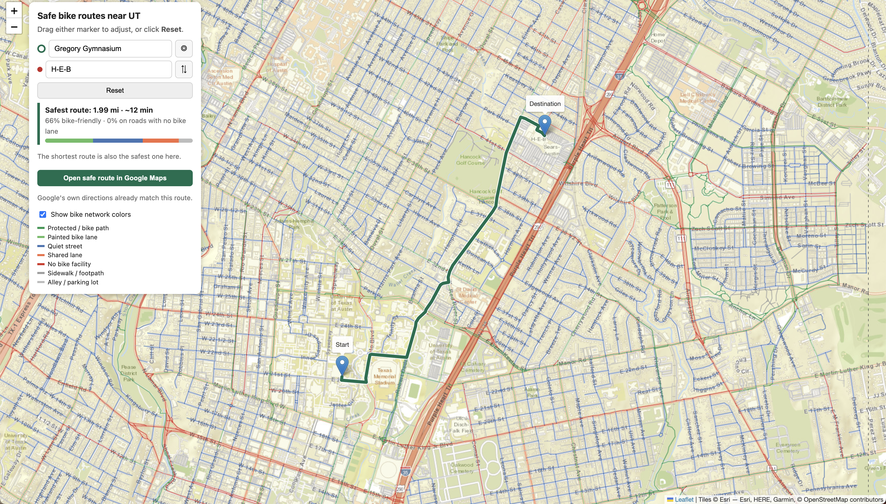

# UT Austin Safe Bike Route Finder

Find the **safest** bike or scooter route between any two places near the University of Texas at Austin — not just the shortest one.

**[Try it live →](https://chipotlesalad.github.io/ut-bike-safety-map/)**



## Why I built this

I get around Austin by bike and scooter, both to class and to get groceries. Navigation apps show the fastest route, not the safest one, and a "bike route" can mean anything from a separated path to a painted line next to fast traffic. I wanted a tool that shows the tradeoff directly: *this route adds 0.3 miles but keeps you off busy roads.*

## Features

- **Search like a maps app** — type an address, building, business, or keyword ("coffee", "grocery", "gym"). Handles typos, abbreviations ("apts"), and short names ("GDC").
- **Safest vs. shortest** — draws both routes and compares distance, time, and the share of each route on bike-friendly streets.
- **Open in Google Maps** — sends the safe route to Google Maps for turn-by-turn navigation, with stops placed so Google follows the route instead of doubling back.
- **Bike network layer** — color-codes every street by its bike infrastructure.
- Works on phones; runs entirely in the browser.

## How it works

1. **Street data.** [OSMnx](https://github.com/gboeing/osmnx) downloads the street network around campus from [OpenStreetMap](https://www.openstreetmap.org).
2. **Safety classification.** Each street segment is categorized from OpenStreetMap's bike tags (`cycleway`, `bicycle`) and road type (`highway`).
3. **Safety-weighted routing.** Every segment's length is multiplied by a danger penalty, and [Dijkstra's algorithm](https://en.wikipedia.org/wiki/Dijkstra%27s_algorithm) finds the cheapest path. A road with no bike lane counts as 4× its real length, so the router rides a bit farther to avoid it:

   | Street type | Penalty |
   |---|---|
   | Protected bike lane / bike path | 1.0× |
   | Quiet residential street | 1.2× |
   | Painted bike lane | 1.3× |
   | Alley / parking lot | 1.5× |
   | Sidewalk / footpath | 1.6× |
   | Shared lane ("sharrows") | 2.0× |
   | No bike facility | 4.0× |

4. **Google Maps hand-off.** Google plans each leg between stops on its own, which can cause out-and-back detours. Before building the link, the app simulates Google's routing and only places stops where continuing forward is clearly better than turning around, with a safety margin so small differences in how Google weighs streets can't flip it. I tested this against a simulated Google that scores streets up to 20% differently: 0 out-and-backs in 1,000 random trips, vs. 42 with my first approach.
5. **Place search.** Named places are downloaded from OpenStreetMap with keywords (e.g. café → coffee) and searched in the browser with typo tolerance. Street addresses come from [Photon](https://photon.komoot.io).

## Run it yourself

Requires Python 3.

```bash
pip3 install osmnx folium
python3 route_finder.py      # builds route_map.html
open route_map.html          # macOS; on Windows, double-click the file
```

Tune the penalties in `CATEGORIES` at the top of `route_finder.py`, or change `CENTER` and `RADIUS_M` to map a different area. `bike_map.py` builds the simpler color-coded network map.

## Roadmap

- [x] Color-coded bike infrastructure map
- [x] Safest-route finder with place search
- [x] Google Maps hand-off for turn-by-turn navigation
- [ ] Bike crash hotspots from Texas crash records
- [ ] Time-of-day traffic
- [ ] Scooter mode

## Limitations

OpenStreetMap is volunteer-maintained, so some streets may be mislabeled and some places may be missing. I'm checking routes against rides I actually take and tuning the model as I go.

## Data and credits

Street and place data © [OpenStreetMap contributors](https://www.openstreetmap.org/copyright). Map tiles © Esri. Address search by [Photon](https://photon.komoot.io).
